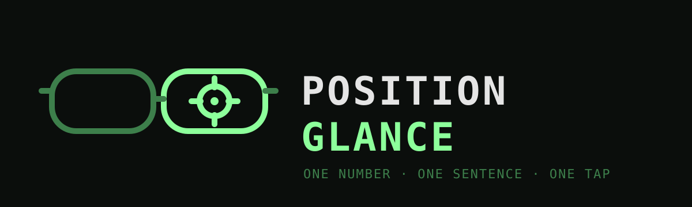
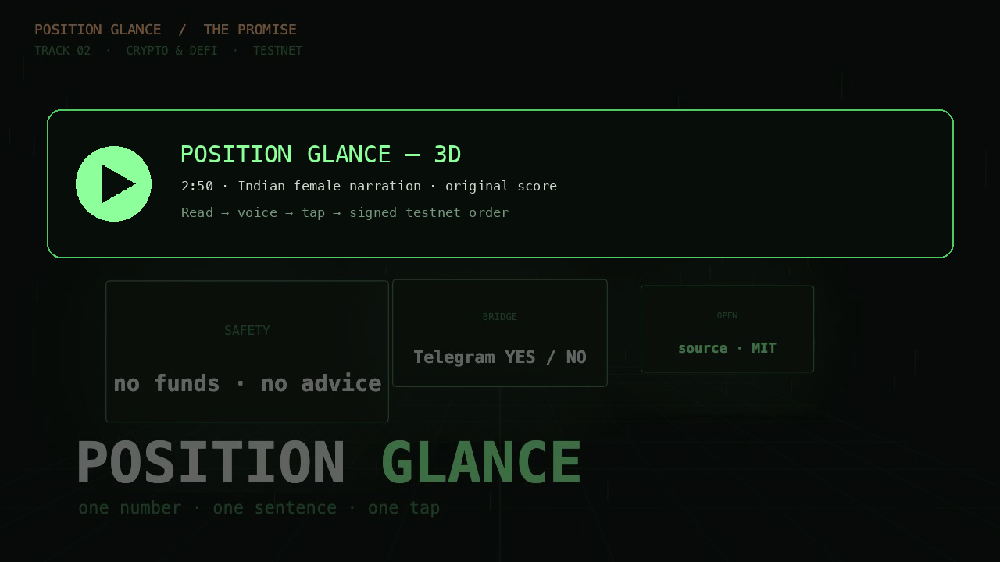

# Position Glance



[](https://github.com/aishwaryanevrekar/position-glance/actions/workflows/ci.yml)
[](tests/smoke.mjs)
[](LICENSE)
[](https://nodejs.org)
[](CONTRIBUTING.md)

**Track 02 · Crypto & DeFi** — G2 smart-glasses app that shows one Hyperliquid testnet position with unrealized PnL, turns a short voice phrase into a reduce-only order, and submits it only after an explicit tap on the glasses or R1 ring.

**Open source under MIT.** Contributions welcome — see [CONTRIBUTING.md](CONTRIBUTING.md), [SECURITY.md](SECURITY.md), [CODE_OF_CONDUCT.md](CODE_OF_CONDUCT.md), [CHANGELOG.md](CHANGELOG.md), [brand.md](brand.md), [MOTION.md](MOTION.md) and [docs/ARCHITECTURE.md](docs/ARCHITECTURE.md).

## 🆓 Try it free, no glasses or keys

Open the **Virtual G2 Trial** at `http://localhost:8787/trial/index.html` after `npm run server`. It renders the 576×288 green lens inside a browser glasses frame and runs the real API flow on simulated testnet data. No account, no API key, no payment, no funds — everything is local and MIT licensed. The 3D scene source is in `video3d/index.html` and is fully deterministic (`window.seek(t)`).

> One number. One sentence. One tap.

## 🎬 Watch the demo — 2:50

[](https://raw.githubusercontent.com/aishwaryanevrekar/position-glance/master/docs/demo-3d.mp4)

**Click the poster to play the film** — a code-rendered 3D data space, six depth-layered scenes, Indian-English female narration (Tara, en-IN), and an original score written in code. Exactly **2:50**, inside the 3-minute submission limit. No paid model, no video generator, no account.

[▶ Watch the film (raw MP4, opens in browser)](https://raw.githubusercontent.com/aishwaryanevrekar/position-glance/master/docs/demo-3d.mp4) · [Short loop GIF](docs/demo-3d.gif) · [Narration script](video3d/script.md) · [3D scene source](video3d/index.html) · [Regenerate](tools/render_3d.mjs)

---

## The problem

Checking a position on a phone means unlocking, finding the app, reading a dashboard and tapping through confirmations. On G2 the same moment should take a glance and a phrase: *"close half my BTC long"* → `SELL 0.025 BTC, reduce-only` → tap to approve → done. Nothing is sent before the explicit confirmation, and the app never tells the user what to do.

## How it works

1. **Read** — backend polls Hyperliquid testnet `/info` (`clearinghouseState` + `allMids`) for one public address. No credentials are needed for reads.
2. **Glance** — the lens shows four short rows: coin/side/size, unrealized PnL and ROE, mark price, and a `SIMULATED` / `TESTNET · NO ADVICE` label.
3. **Voice** — tap starts G2 microphone capture; PCM (16 kHz s16le mono) is streamed to the backend, wrapped in WAV and transcribed.
4. **Intent** — transcript → strict JSON `{action, coin, fraction|size, side}` via Claude/OpenRouter, with a deterministic parser fallback. It resolves against the live position into an exact reduce-only size.
5. **Consent** — the parsed order is shown on the lens. **Tap = YES**, **swipe = NO**, **double-tap = exit**. A one-use, 60-second consent token is issued.
6. **Write** — only after YES does the backend sign and submit a reduce-only `IoC` order through an **agent wallet with no withdrawal rights**. The private key never leaves the server and never enters the WebView.

## Optional Telegram bridge (Track 01 + Best Telegram prize)

Set `TELEGRAM_BOT_TOKEN` (from `@BotFather`) to enable a second-track flow with no extra infrastructure — long polling, no webhook or TLS:

- `/pair 0x...` — pair a public master address (read-only)
- `/status` — show the same one-position glance in chat
- `/close half` / `/close all` — draft a reduce-only order, then confirm with an inline **YES · SEND** / **NO · CANCEL** button
- Every order confirmed on the glasses pushes the same receipt to paired chats

This makes the build genuinely eligible for both **Track 02** and **Track 01** plus the **$1,000 Best Telegram integration** special prize. The bot token stays on the backend. With no token set, the bridge is simply disabled and the app is a pure Track 02 entry.

## Safety

- Testnet only; demos use simulated data by default (`DEMO_MODE=true`).
- No custody, no user funds, no withdrawals, no financial advice — the app never recommends an action.
- Reduce-only orders cannot increase exposure.
- All secrets live on the backend; `app.json` whitelists only the backend origin.
- Message/position data is not stored; consent tokens are in-memory, one-use and expire after 60 seconds.

## Build for G2

- 576×288 monochrome, at most four lines, one event-capturing container.
- `waitForEvenAppBridge()` is awaited before any SDK call.
- `textContainerUpgrade` avoids flicker; double-tap always calls `shutDownPageContainer(1)`.
- Voice uses `AudioInputSource.Glasses` with `g2-microphone` permission.
- State is safe if the WebView is suspended: re-armed mic on foreground, no black first screen.

## Run locally (no keys, no glasses)

```bash
# terminal 1 — backend (demo mode)
npm run server

# terminal 2 — optional browser preview of the 576×288 lens
open http://localhost:8787/demo/index.html

# open http://localhost:8787/api/position to see the simulated feed
```

Everything works in demo mode: the transcript parser, the consent token and the signed-order receipt are all real code paths with simulated data, clearly labelled `SIMULATED`.

## Run on the G2 simulator / device

```bash
npm install
npm run dev            # vite at http://localhost:5173
npm run simulate       # Even Hub simulator pointed at the dev server
```

To go live on testnet, copy `.env.example` to `.env` and set:

- `DEMO_MODE=false`
- `HYPERLIQUID_ADDRESS` — the **master/sub-account** address to watch (not the agent wallet — that returns empty positions)
- `HYPERLIQUID_AGENT_PRIVATE_KEY` — a testnet API wallet with **no withdrawal rights**, minted at https://app.hyperliquid-testnet.xyz/API
- Optional: `OPENAI_API_KEY` for real STT, `ANTHROPIC_API_KEY` or `OPENROUTER_API_KEY` for real intent parsing
- `ALLOWED_ORIGIN` — the simulator/dev origin to allow through CORS

Then `npm run pack` to produce the `.ehpk`. The `app.json` whitelist is **not** a CORS bypass, so the backend sets CORS headers explicitly.

## Built during the hackathon

Everything in this repository was written during the 23–29 Nov 2026 build week. Pre-existing code used:

- `@evenrealities/even_hub_sdk`, `@evenrealities/evenhub-cli`, `@evenrealities/evenhub-simulator` — official Even tooling
- `@nktkas/hyperliquid` and `viem` (optional) — community Hyperliquid SDK and Ethereum account signing
- The official `minimal` Even Hub template was consulted for the bridge/page lifecycle pattern; the app logic, backend, parsers, signer and UI in this repo are original.

## Feature requests for the APIs used

1. Hyperliquid: a documented testnet faucet and agent-wallet approval flow inside the app UI.
2. Even Hub SDK: a documented system-browser deep-link handoff for third-party OAuth (Google sign-in does not work in the WebView).
3. Even Hub simulator: scriptable microphone injection from an audio file for automated STT testing.
4. Even Hub: a documented way to receive an `onForeground` event so mic re-arming does not rely on a container rebuild.
5. Hyperliquid: an `orderStatus` subscription so a filled/rejected result can push to the lens instead of being polled.

## Files

```
app.json                 Even Hub manifest (permissions, entrypoint)
index.html               WebView shell
src/main.ts              G2 app: state machine, mic, events, on-lens confirmation
server/server.mjs        HTTP API + CORS + static preview
server/config.mjs        env (no secrets sent to client)
server/hyperliquid.mjs   /info reads, demo fixture, formatting
server/intent.mjs        WAV wrapping, STT, intent parsing, size resolution
server/signer.mjs        one-use consent tokens, reduce-only testnet signing
server/telegram.mjs      optional Track 01 bridge: pairing, status, YES/NO close, receipts
demo/index.html          browser preview of the 576×288 lens + live API trace
tools/make_3d_poster.py  builds the clickable README poster
assets/logo.svg|png      vector and raster logo; icon.svg|png square icon
video3d/index.html       deterministic code-rendered 3D scene (window.seek)
video3d/script.md        narrated script for the 2:50 film
tools/render_3d.mjs      renders frames, voice and score into the 3D film
trial/index.html         free virtual-G2 browser trial, no keys or funds
tests/smoke.mjs          8 dependency-free backend checks
.github/workflows/ci.yml backend smoke test + client build
docs/ARCHITECTURE.md     sequence diagram, safety boundaries, limitations
docs/                    demo-3d.mp4 (2:50 film), demo-3d.gif, demo-3d-poster.png
```

Run `npm test` for the dependency-free smoke test and `npm run check` for syntax validation.
