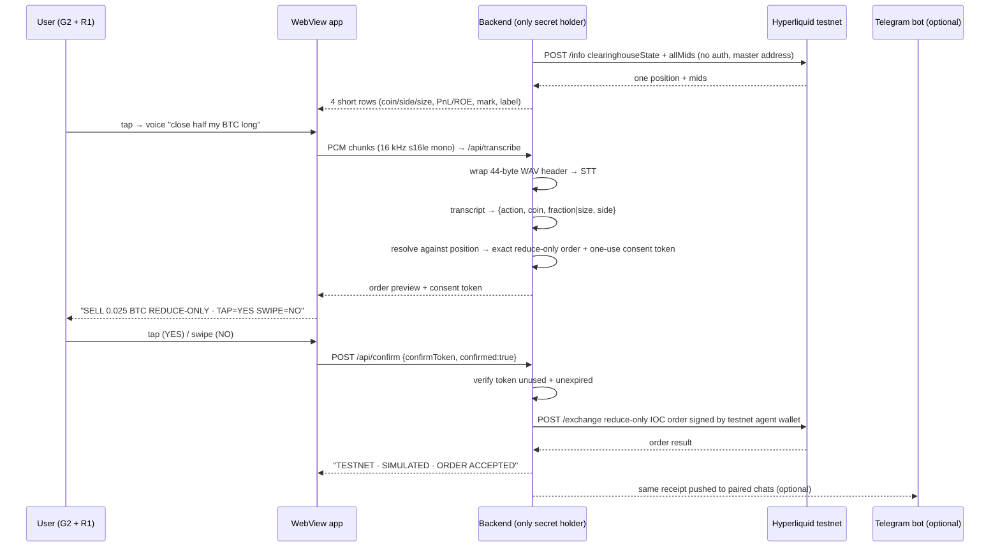

# Architecture

Position Glance is deliberately narrow: one position, one spoken intent, one explicit confirmation, one signed testnet order.

## Components

| Layer | Files | Responsibility |
|---|---|---|
| G2 WebView | `src/main.ts`, `index.html` | Render one glance, capture mic, route tap/swipe/double-tap, show the parsed order and receipt |
| Even Hub bridge | `@evenrealities/even_hub_sdk` | `waitForEvenAppBridge()`, `createStartUpPageContainer`, `textContainerUpgrade`, `audioControl`, events |
| Backend | `server/server.mjs` | Single CORS-enabled origin for the WebView; all secrets live here |
| Read adapter | `server/hyperliquid.mjs` | `POST /info` → `clearinghouseState` + `allMids`, one-position formatter, demo fixture |
| Language adapter | `server/intent.mjs` | PCM → WAV → STT, transcript → strict JSON intent, resolve to exact reduce-only size |
| Consent + signer | `server/signer.mjs` | One-use 60-second tokens; EIP-712/msgpack testnet order via agent wallet |
| Telegram bridge | `server/telegram.mjs` | Optional Track 01 flow: pairing, status, YES/NO close, receipt push |

## End-to-end flow

## Safety boundaries

1. **Read path needs no credentials.** `/info` is queried with a public master/sub-account address, never the agent wallet (which would return empty positions).
2. **Write path needs a scoped key.** A Hyperliquid API agent wallet is minted with no withdrawal rights and is held only by the backend. Reduce-only orders cannot increase exposure.
3. **Explicit consent.** No order is signed until the user confirms on the lens; the token is one-use and expires after 60 seconds. Declining sends nothing.
4. **No advice.** The app displays raw size, entry, mark and PnL. It never outputs a recommendation, score or "should I close?" prompt.
5. **No secrets in the client.** `.env` is gitignored; CI checks for committed keys; the `.ehpk` contains no keys.
6. **Two network gates.** `app.json` `network.whitelist` allows the origin at the Even layer, and the backend sets CORS headers for the WebView layer. One without the other fails.
7. **Testnet only.** Default `DEMO_MODE=true` broadcasts nothing and labels every receipt `TESTNET · SIMULATED`.

## Why it is "complex" in the right way

Complexity is vertical, not horizontal: a real signed write, a visible consent step, a privacy-preserving data path and an on-glasses UX that survives WebView suspension. It is intentionally not a multi-service dashboard. Total reward weight for usefulness + read/write is 55%, so depth in one trusted loop beats breadth.

## Known limitations

- One position is displayed; multi-symbol cycling was cut to preserve the glanceable UX.
- The checked-in demo video is rendered from real backend responses with a mock lens; the competition submission should use a recording of `evenhub-simulator` or a G2 device.
- Android WebView suspension requires re-arming the mic on foreground; this is handled in the event layer but should be verified on a beta build with a locked phone.
- Real STT/intent calls require keys; without them the deterministic parser is used and clearly labelled simulated.
